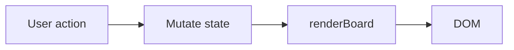
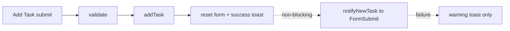

# IT PMO Kanban Board

A single-file Kanban board demo for an IT PMO at a **fictitious** bank. Vanilla HTML, CSS and JavaScript. No build, no dependencies, no persistence.

**Live demo:** https://lehuigame1-afk.github.io/claudetraining/

<!-- Screenshot placeholder: add docs/screenshot.png and reference it here -->


## Features

- Four columns: **Backlog**, **In Progress**, **Blocked**, **Done**.
- Cards show ID (`UOB-ITPM-####`), title, project, category, assignee, priority and due date.
- Drag and drop between columns, or use each card's keyboard-accessible **Move** menu.
- **Add Task** modal with inline validation.
- Filters by project, assignee and priority, plus a Clear button.
- Board summary with per-column counts.
- Overdue highlighting (any non-Done task due before today).
- Inline "Delete? Yes / No" confirmation (no `alert()` / `confirm()`).
- Toast notifications; respects `prefers-reduced-motion`.
- Optional email notification for each new task via [FormSubmit](https://formsubmit.co).

## Architecture

Everything lives in `index.html` (markup, `<style>`, `<script>`). All behaviour hangs off one in-memory `state` object (`tasks`, `filters`, plus UI sub-state `pendingDeleteId`, `openMoveId`, `draggingId` and the `nextId` counter). The rule: **mutate `state`, then call `renderBoard()`**. Card DOM is only written by `renderBoard()` / `renderCard()` via `innerHTML`, so every user-supplied string goes through `escapeHtml()`.

Because the board is re-rendered wholesale, events use delegation on `#board` (clicks via `data-action` attributes; `dragstart` / `dragover` / `dragleave` / `drop`), and focus is restored explicitly with `focusCard()`.

Seed dates are computed relative to today (`offsetDate`), so overdue cards always appear in the demo.





A FormSubmit failure only produces a warning toast and never affects the board.

## Constraints

- Vanilla HTML/CSS/JS only: no frameworks, CDN scripts, web fonts or image files.
- **No persistence** (no localStorage, sessionStorage, IndexedDB or cookies). Refreshing resets the board to the seeded data.
- **One external call**: the FormSubmit AJAX endpoint.
- No `!important`, no `alert()` / `confirm()`.

## Install / run

```bash
git clone https://github.com/lehuigame1-afk/claudetraining.git
cd claudetraining
```

Open `index.html` in a browser (double-click or a `file://` URL). No build, no npm.

## Configuration

Edit `FORMSUBMIT_ENDPOINT` at the top of the `<script>` in `index.html`:

```js
const FORMSUBMIT_ENDPOINT = "https://formsubmit.co/ajax/YOUR_EMAIL@example.com";
```

The first submission triggers a FormSubmit activation email to that address; click the link in it once. **This repository is public**, so anything committed here is public. Prefer FormSubmit's random-string alias over a raw email address, or keep your real address out of commits.

Each notification contains only the new task's own fields (ID, title, description, project, category, assignee, priority, due date, status, submitted-at).

## CI/CD

- `.github/workflows/ci.yml`: on push/PR to `main`, runs HTML validation, a JS syntax check of the inline script, a policy check (no persistence APIs, `!important`, `alert` / `confirm`, external scripts or unexpected URLs) and a Gitleaks secret scan.
- `.github/workflows/pages.yml`: deploys only `index.html` to GitHub Pages on push to `main`.
- Dependabot keeps GitHub Actions versions current.

## Security

No data is stored in the browser. The only network call is to the FormSubmit endpoint, and only when a task is added. CI enforces both.

## Disclaimer

This is a fictitious demo. It is not affiliated with, endorsed by or representative of any real bank. The task ID prefix is illustrative only.
